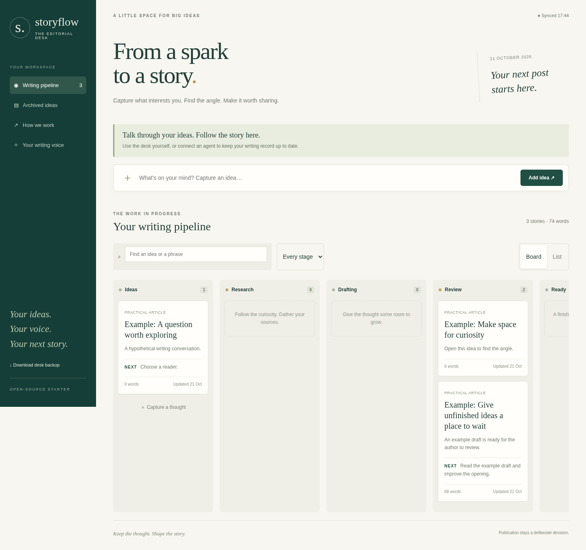
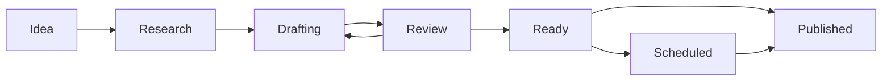

# StoryFlow

**Talk through an idea. See it become a story.**

StoryFlow is a small, self-hosted editorial desk for authors who want a visible
record of their ideas, decisions, drafts, and next steps. Use it yourself, or
give a connected coding agent access to its local API so it can maintain the
record as you discuss your writing.



**v0.1 is an early, single-workspace foundation—not a hosted publishing service.**
It uses Python's standard library, SQLite, and plain HTML/CSS/JavaScript. There
is no runtime package install, frontend build, AI account, or WordPress account
needed to run the board.



Research and scheduling are optional. Stage changes record work; they do not
publish anything. Publication remains the author's deliberate decision.

## Try it locally

Install Python 3.11 or newer. Download and extract the source, or clone this
repository. Open a terminal in the project folder and run:

```sh
python3 webapp/server.py
```

On Windows, use `py -3` instead of `python3`. Open
**http://127.0.0.1:8799**. Stop with Ctrl+C. Your work persists in
`state/editorial-desk.sqlite3` across restarts. Keep that data private and backed up.

To explore a fictional example in a separate database, stop the server and run:

```sh
python3 tools/demo.py --db state/demo.sqlite3
python3 webapp/server.py --db state/demo.sqlite3
```

The demo loader refuses a nonempty database. It creates an example story with
saved revisions from idea to review. [Walk through it](docs/demo.md).

## What you get

- Seven stages, board/list views, search, archive and restore.
- Brief, source notes, draft, review checklist, and writing-voice profile.
- Conversation summary, decisions, open questions, next action, and activity timeline.
- Saved revisions and conflict checks to protect work edited in another tab or by an agent.
- Markdown handoffs, JSON export, and a tested SQLite backup/restore tool.
- A local API and [agent workflow](docs/conversation-workflow.md) you can adapt.

The board refreshes saved state every five seconds. It is **not a transcript
collector**. StoryFlow does not include an AI model, initiate conversations,
connect an ordinary cloud chat to your computer, publish posts, generate audio,
or run background agents. Those require separately configured tools and accounts.

## Make it yours

Edit `editorial-profile.md`, or pass `--profile /path/to/profile.md`. The browser
displays dates in its local timezone. Confirm exact publication times and
timezones explicitly in the Decisions field.

```sh
python3 webapp/server.py --port 8799 --db state/my-desk.sqlite3 --profile editorial-profile.md
```

Read [the author workflow](docs/conversation-workflow.md),
[API reference](docs/api.md), [optional integrations](docs/integrations.md), and
[operation and recovery](docs/operations.md). A connected agent should start
with [AGENTS.md](AGENTS.md). Manual use works without an agent.

## Private phone access

The server listens on loopback only. There is no app login; everyone allowed
to reach the service can read and change all its content. Use a trusted private
network proxy such as Tailscale Serve for phone access. See
[private access instructions](docs/operations.md#private-phone-access).
Do not expose this server directly to the public internet or enable Funnel.

## Development and release status

```sh
python3 -m unittest discover -s tests -v
node --check webapp/app.js
```

Node is needed only for JavaScript validation and the optional browser test,
not to run the application. CI tests on Linux, macOS, and Windows and runs a
browser smoke test. See [CONTRIBUTING.md](CONTRIBUTING.md).

v0.1 has no user accounts, access roles, automatic publishing, JSON import UI,
or automatic revision rollback. Old versions are readable and can be copied
into a new revision. JSON export is a portable data export; use the SQLite
backup tool for complete restoration. See [release notes](CHANGELOG.md) and
the [release checklist](docs/releasing.md).

## License and origin

Code, documentation, and the fictional example are under the [MIT license](LICENSE).
StoryFlow grew out of a personal writing workflow. This repository starts with
fresh history and includes no personal posts, production database, avatar,
private account settings, WordPress plugin, or narration engine. Optional
third-party services and dependencies have their own terms and licenses.

Read [SECURITY.md](SECURITY.md) before changing the deployment model.
